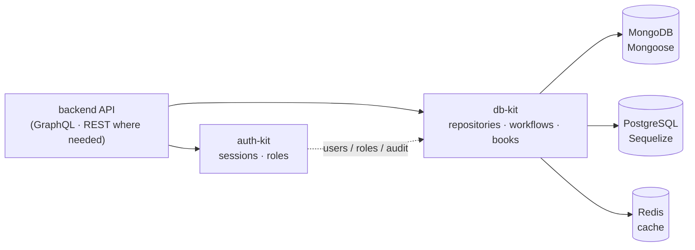

<div align="center">

# db-kit

**The data layer of the MGPL Diagnostics backend.**
One domain model on **MongoDB** or **PostgreSQL**, ACID workflows, Tally-style double-entry books
and a Redis cache toolkit, as an internal API the backend calls. It serves no endpoints of its own.

  

</div>



## Start

```ts
import { createDb, registerPatient, issueInvoice, trialBalance } from "@mgpl-diagnostics/db-kit";

const db = await createDb({
  backend: "pg",                                   // or "mongo"
  pg: { url: process.env.DATABASE_URL },           // mongo: { uri: process.env.MONGO_URL }
  redis: process.env.REDIS_URL,                    // optional: cache + cached reads
});

const patient = await registerPatient(db.repos, { orgId, branchId, name: "Asha Patel", sex: "female", ageYears: 29 });
const { invoice } = await issueInvoice(db.repos, {
  orgId, branchId, patientId: patient.id,
  items: [{ code: "CBC", name: "Complete Blood Count", ratePaise: 39900 }],
  payments: [{ amountPaise: 39900, mode: "upi" }],
});
const tb = await trialBalance(db.repos, { orgId });  // tb.totalDebitPaise === tb.totalCreditPaise
```

`createDb` loads only the backend you pick: Mongo users never load Sequelize, and the other way round.
Tables and collections, with their indexes, are created on start (`sync: false` to skip).

## What's inside

### Domain

| Area | Entities |
| --- | --- |
| Organisation | organisations, branches (lab / collection centre) |
| Access | users (roles per branch), roles, audit log. Passwords and sessions live in **auth-kit** |
| Lab | patients (UHID), referring doctors, bookings, samples (barcodes), reports |
| Billing | invoices (GST, discounts, round-off, B2B customer, place of supply), payments and refunds, credit notes |
| Books | account groups, ledgers, vouchers, ledger entries, lock dates |
| Finance | B2B customers, collection-centre partners and agreements, monthly settlements, day-end cash closings, bank statements and lines, GST tax rules. Rules live in [finance-kit](https://github.com/mgpl-diagnostics/finance-kit); see [docs/FINANCE-STORAGE.md](docs/FINANCE-STORAGE.md) |

Ids are **UUID strings on both databases**, so data and code move between them unchanged. Money is
**integer paise** everywhere.

### Workflows

Each workflow runs in a transaction and writes an audit entry:

| Function | Does |
| --- | --- |
| `seedOrganization` | organisation + roles + first branch + owner |
| `registerPatient` | UHID from a gap-free counter (`MGPL-000123`) |
| `createBooking` | booking number per branch per day, one sample barcode per sample type |
| `saveResults` · `transitionReport` | draft → entered → verified → released → amended |
| `issueInvoice` | numbers it in the branch's financial-year series (`MGPL/RPR01/2026-27/000045`), computes totals, takes payments, **posts a Sales voucher** |
| `recordPayment` | payment or refund; locks the invoice; **posts a Receipt / Payment voucher** |
| `cancelInvoice` | only when unpaid; cancels its Sales voucher |

### Tally-style books

| | |
| --- | --- |
| Chart of accounts | Tally's 28 groups (`TALLY_GROUPS`) and lab ledgers (`DEFAULT_LEDGERS`: Cash, UPI, Card, Bank, Patient Receivables, Lab Test Income, Output CGST/SGST/IGST, Discount, Round Off…) via `seedChartOfAccounts` |
| Vouchers | Sales, Receipt, Payment, Journal, Contra, Credit/Debit Note, Purchase, Closing (year end). Numbered per type per financial year; debits must equal credits (`assertBalanced`) |
| Lock dates | per organisation or branch: no voucher on or before the lock date may be posted or cancelled (`PeriodLockedError`, 409). Checked inside the posting transaction, safe under concurrency |
| Automatic posting | invoice → Dr Receivables / Dr Discount / Cr Income / Cr GST / ± Round Off; payment → Dr Cash·UPI·Card / Cr Receivables. Replaceable through a `PostingHook` (`createDb({ posting })`) |
| Reports | `trialBalance` · `ledgerStatement` (running balance) · `cashBook` · `dayBook` · `profitAndLoss` (gross and net) · `balanceSheet` · `outstandingReceivables` (ageing) · `gstSummary` |

### ACID on both databases

| | MongoDB | PostgreSQL |
| --- | --- | --- |
| Atomic workflows | multi-document transactions (snapshot reads, majority writes) | managed transactions |
| No lost updates on payments | the write lock is taken inside the transaction | `SELECT … FOR UPDATE` |
| Retries | `withTransaction` retries transient errors | retries deadlocks and serialization failures (40P01 / 40001) |
| Safety | **refuses** to run without a replica set (`TransactionsUnsupportedError`) | — |

Tests prove each guarantee on both databases: a failed transaction leaves nothing (not even a used counter); of two concurrent overpayments, exactly one succeeds; a second transaction waits for the invoice lock.

### Cache toolkit (`/cache`)

| Technique | Use |
| --- | --- |
| cache-aside + TTL jitter | `cache.getOrSet(key, loader, { ttl })` |
| single-flight | 20 concurrent misses → 1 load per process |
| stampede lock | across servers, one loads and the others wait for its value |
| stale-while-revalidate | `staleTtl`: serve stale instantly, refresh in the background |
| negative caching | `negativeTtl`: remember "not found" |
| tags | `invalidateTags("patient:42")` |
| versioned namespaces | `cache.namespace("catalog").bump()` drops a namespace in O(1) |
| two-tier L1 + Redis | in-process LRU; pub/sub clears every server's L1 on writes |
| cached repositories | `withCache(repos, cache)`: reads by id cached, writes invalidate |
| rate limiters · locks | `slidingWindowLimiter`, `fixedWindowLimiter`, `withLock` |

### Mounting in a backend

```ts
import { mgplDb } from "@mgpl-diagnostics/db-kit/fastify";
await app.register(mgplDb, { backend: "mongo", mongo: { uri }, redis: process.env.REDIS_URL }); // → app.db

import { attachDb, dbErrorHandler } from "@mgpl-diagnostics/db-kit/express";
app.use(attachDb(db)); /* routes */ app.use(dbErrorHandler());
```

Errors carry `statusCode`:

| Error | Status |
| --- | --- |
| `NotFoundError` | 404 |
| `ConflictError` | 409 |
| `PeriodLockedError` (a `ConflictError`) | 409 |
| `ValidationError` | 400 |
| `UnbalancedVoucherError` | 422 |

## Entry points

| Import | Contents |
| --- | --- |
| `@mgpl-diagnostics/db-kit` | types, repository interface, workflows, money, numbering, accounting, reports, `createDb` |
| `…/mongo` · `…/pg` | `createMongoRepositories` · `createPgRepositories`, schemas / models |
| `…/cache` | the cache toolkit |
| `…/fastify` · `…/express` | adapters |
| `…/graphql` | **moving to the backend repo.** See [docs/MOVE-GRAPHQL-TO-BACKEND.md](docs/MOVE-GRAPHQL-TO-BACKEND.md) |

Peer dependencies are all optional: install only the ones you use (`mongoose`, or `sequelize` + `pg`
+ `pg-hstore`; `ioredis`; `fastify`).

## Tests

```bash
npm test   # 194 checks
```

The suite starts a real MongoDB (single-node replica set) and a real PostgreSQL in-process, then runs
the same contract suite on both. It covers seeding, numbering, workflows, ACID, the books, the finance
storage (unique keys, row locks, lock dates under concurrency, the posting hook), the cache techniques
and the adapters. Set `REDIS_URL` to run the cache checks against real Redis instead of
`ioredis-mock`.

## Family

| Repo | Role |
| --- | --- |
| **db-kit** | data, workflows, books, cache |
| [auth-kit](https://github.com/mgpl-diagnostics/auth-kit) | passwords, sessions, roles (internal API) |
| [catalog-kit](https://github.com/mgpl-diagnostics/catalog-kit) | tests, ranges, prices, search |
| [report-kit](https://github.com/mgpl-diagnostics/report-kit) · [invoice-kit](https://github.com/mgpl-diagnostics/invoice-kit) | A4 PDF + HTML |
| [client](https://github.com/mgpl-diagnostics/client) | headless frontend SDK |

## Licence

All rights reserved. See [LICENSE](LICENSE).
